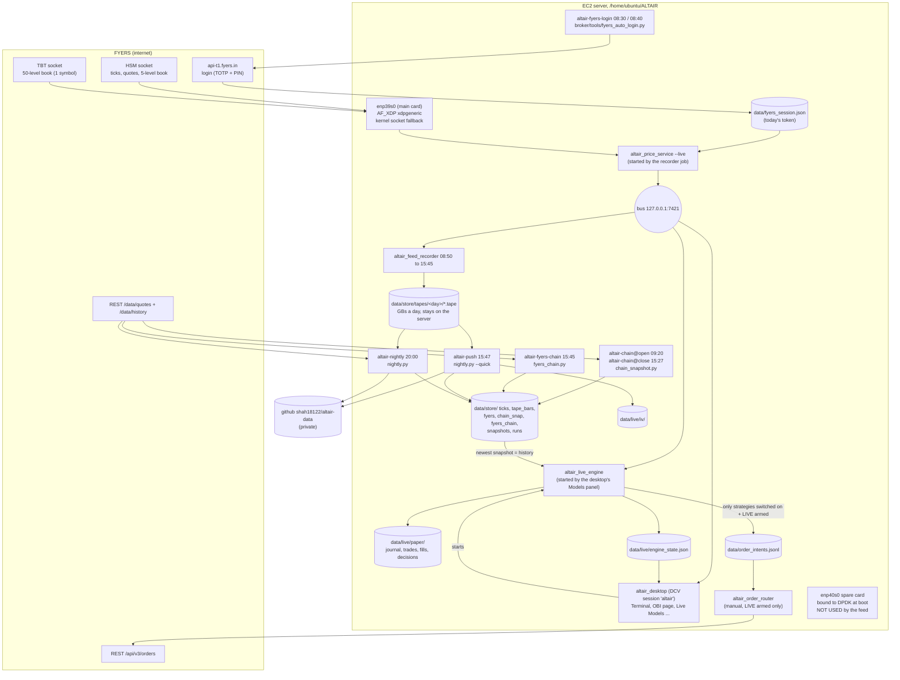

# ALTAIR data flow: who does what, where the data comes from, where it goes

Written 2026-11-05 from the code on `main` (18a041f), the systemd units in
`ops/systemd/`, and the server's own activity log for 2026-11-04 as pushed to
`altair-data`. Times are IST. Everything here runs on the EC2 server
(`/home/ubuntu/ALTAIR`, Ubuntu 24.04, Mumbai); Windows is gone.

**Short version**

1. At 08:30 the server logs in to FYERS by itself and saves the day's token.
2. At 08:50 the recorder starts **one** FYERS feed (`altair_price_service`) and
   records everything it publishes. Since 2026-11-04 14:30 that feed runs over
   AF_XDP (kernel bypass) on the main card `enp39s0`.
3. Everything else that is live (the desktop pages and the models engine)
   reads that same feed from a loopback socket, `127.0.0.1:7421`. Nothing
   opens a second FYERS connection.
4. The models engine (`altair_live_engine`) runs **inside the desktop
   session**, not as a service. Every model is **paper only**; no real order
   goes out unless you arm LIVE on the Terminal and start the order router.
5. At 15:47 the day is decoded and pushed to `altair-data`. At 20:00 FYERS
   candles are fetched, a snapshot is built, the forecast curriculum is
   retrained, and the data is pushed again.

**What is broken or dead today** is listed at the end, in
[Problems found](#problems-found). The biggest one: the server holds only
**6 days** of FYERS history, so most of the daily models cannot start.

---

## 1. The picture

---

## 2. The day, in order (IST, Monday to Friday)

| Time | systemd timer | What runs | Reads | Writes |
|---|---|---|---|---|
| boot | `altair-dpdk-bind.service` | `ops/linux/dpdk_bind.sh enp40s0` | `/etc/altair/dpdk.conf` | the spare card on `vfio-pci` (unused by the feed) |
| boot + 90 s | `altair-recorder.timer` | `record_session.py --go` (exits at once outside 08:45-15:45 or on a weekend) | | |
| 08:30, 08:40 | `altair-fyers-login.timer` | `broker/tools/fyers_auto_login.py --retry-minutes 10` | server vault (app id, secret, user id, PIN, TOTP key) | `data/fyers_session.json` |
| 08:50 | `altair-recorder.timer` | `record_session.py --go` → `altair_feed_recorder` + `altair_price_service --live` | FYERS HSM + TBT sockets, the token | `data/store/tapes/<day>/`, `data/live/feed_status.json`, `data/live/universe.csv`, bus 7421 |
| 09:00 → | (desktop) | Terminal connects to the bus; Models panel starts `altair_live_engine` once the feed streams | bus 7421 | `data/live/engine_state.json`, `data/live/paper/*` |
| 09:20 | `altair-chain-open.timer` | `chain_snapshot.py --go` (REST quotes of every NIFTY/BANKNIFTY strike) | FYERS `/data/quotes` | `data/store/chain_snap/<day>/0920.csv` |
| 15:27 | `altair-chain-close.timer` | same | same | `.../1527.csv` |
| 15:45 | (recorder) | recorder and price service stop (`--until 15:45`) | | last tape closed |
| 15:45 | `altair-fyers-chain.timer` | `fyers_chain.py --go` (1-minute bars of the listed futures and near strikes) | FYERS `/data/history` | `data/store/fyers_chain/<day>/` |
| 15:47 | `altair-push.timer` | `nightly.py --go --quick`: wait for the recorder, decode, IV, trade summary, push | tapes | `data/store/ticks/`, `tape_bars/`, `data/live/iv/`, **altair-data** |
| 20:00 | `altair-nightly.timer` | `nightly.py --go`: decode, IV, FYERS candles (7-day backfill), snapshot, retrain, trade summary, tidy, push | tapes, FYERS history | `data/store/fyers/`, `snapshots/<day>/`, `runs/<day>/`, **altair-data** |

If the token is missing, the recorder retries the login every 5 minutes up to
15:30 and starts the feed the moment a new token is written. A new token
during the session (the 08:40 backstop, a forced login) restarts the feed.

---

## 3. Each stage in detail

### 3.1 FYERS login and token
- **Code:** `broker/tools/fyers_auto_login.py` (TOTP + PIN, no browser).
- **Secrets:** only in the server vault / `/etc/altair/altair.env`. Never in git.
- **Output:** `data/fyers_session.json`. It lasts one trading day.
- **Who reads it:** the price service (feed), `chain_snapshot.py`,
  `fyers_chain.py`, the nightly's candle fetch, and the order router.

### 3.2 The feed: `altair_price_service`
- **Started by:** the recorder job, not by the desktop. Since 18a041f the
  desktop never starts its own feed while `altair-recorder.timer` is enabled
  (set `ALTAIR_TERMINAL_FEED=1` to override).
- **Network path:** `--bypass enp39s0 --bypass-ip 172.31.44.249`, written by
  `ops/linux/feed_bypass.sh on enp39s0` into `/etc/altair/altair.env`. That is
  **AF_XDP in generic mode** (`xdpgeneric`) on the **main** card, with ALTAIR's
  own TCP/TLS (`net/user_tcp.hpp`). If the bypass cannot start, it carries the
  feed on the normal kernel socket and says so in its log.
- **DPDK:** the spare card `enp40s0` is bound to DPDK at boot, but **no
  production program uses it.** Only the test tools (`net/tools/dpdk_tls_client_main.cpp`,
  `ops/linux/dpdk_netns_test.sh`) do. The price service has no DPDK option.
- **Universe (the recorder's flags):** NIFTY and BANKNIFTY spot, INDIA VIX,
  near futures, the 3 nearest option expiries ATM ± 40 strikes plus the
  nearest monthly, the NIFTY 50 stocks and their futures, the 5-level book on
  10 strikes each side, and the 50-level TBT book on **1** symbol
  (`--depth50 1`; BANKNIFTY's future is the main subscription).
- **Output:** the bus on `127.0.0.1:7421`, `data/live/feed_status.json`,
  `data/live/universe.csv`, and its log in `data/logs/price_service-<day>.out.txt`.

### 3.3 The recorder: `altair_feed_recorder`
- **Reads:** the bus. It records whatever the price service publishes. SIM and
  replay frames are not recorded.
- **Writes:** `data/store/tapes/<day>/*.tape` (one tape per connection; the
  2026-11-04 session made 5 tapes, about 2.7 GB). Tapes stay on the server:
  they are the only tick history ALTAIR will ever have, because FYERS serves
  no expired options.

### 3.4 The 15:47 push (`nightly.py --quick`)
1. Waits up to 10 minutes for the recorder to exit.
2. `altair_store decode --day <day>` → `data/store/ticks/<day>/` (1-minute
   bars of every instrument, `vol_1m.csv`, `chain_iv_1m.csv`) and
   `data/store/tape_bars/`.
3. `altair_iv_record` over the tapes → `data/live/iv/` (ATM IV each minute).
4. Lists the day's paper and LIVE round trips in the activity log (SIM rows
   are now listed and totalled apart; see the fix below).
5. `push_data.py` → `/srv/altair-data` → GitHub (deploy key).

### 3.5 The 20:00 nightly (`nightly.py`)
Steps 1-3 above again, then:
- **FYERS candles:** 1m/5m/15m/60m/1d for NIFTY 50, NIFTY BANK, INDIA VIX and
  both near futures, for today and the 7 days before, into
  `data/store/fyers/<seg>/<inst>/<tf>/<day>.csv`.
- **Snapshot:** `altair_store snapshot --cutoff <day>` merges
  `data/store/fyers` (main source) with `tape_bars` (fills gaps only) and the
  IV. FYERS only; `dataset/` and bhavcopy are opt-in and off. Result:
  `data/store/snapshots/<day>/`, never rebuilt over; the last 10 are kept.
- **Retrain:** `altair_forecast_curriculum --leak-check` on the snapshot →
  `data/store/runs/<day>/` (`forecast_curriculum.txt/.xlsx`, `forecast_log/`,
  `leak_check.csv`, `run.json`). Exit 0 and a clean leak check writes
  `data/store/runs/LATEST.txt` ("promoted").
- **Push** as above, now with `reports/<day>/` (decode, snapshot manifest,
  conflicts, run.json, curriculum summary, leak check).

### 3.6 What lands in `altair-data`
`bars/<yyyy>/<day>.csv.gz`, `candles/<seg>/<inst>/<tf>/<day>.csv`,
`iv/<INDEX>/<day>.csv`, `vol/<yyyy>/<day>.csv.gz`, `chain_iv/<yyyy>/<day>.csv.gz`,
`chain_snap/<day>/<HHMM>.csv.gz`, `reports/<day>/`, `logs/altair-<day>.log`.
Never tapes, never tokens or session files (checked by name and by content).

---

## 4. Every model and trader

"Paper" means fills are simulated at the live bid/ask with costs, in
`data/live/paper/`. Real orders exist only for strategies whose own switch
is on **and** LIVE is armed on the Terminal **and** `altair_order_router` is
running; no systemd unit starts the router, so today nothing can send a real
order.

### 4.1 Inside `altair_live_engine` (live, every tick, during the session)

History for the daily models comes from the **newest snapshot** in
`data/store/snapshots/` (else `data/store/fyers/`). On the server that
snapshot holds 6 days (2026-10-28 to 2026-11-04), which is why most of the
daily models below are starved.

| Model | Instruments | Inputs | When it acts | Output | Status on the server today |
|---|---|---|---|---|---|
| Vol band (HAR) | NIFTY, BANKNIFTY | 5-minute history (needs 60 days of daily RV) | every minute, trades nothing | the range used by the strangles | **Cannot start:** "too little 5-minute history for HAR" |
| Strangle 80% (plain and stop2x) | NIFTY, BANKNIFTY options | Vol band | 09:20, sells the band's edges | paper trades | **Idle:** needs the Vol band |
| Straddle IV>=RV | NIFTY weekly, BANKNIFTY monthly ATM straddles | live ATM IV, HAR RV, VIX HAR (needs >60 VIX closes) | every tick; sells when forecast IV (bid) >= forecast RV | paper trades, each with its reason | **Blocked** for lack of RV/VIX history; it logs the reason every day |
| Straddle book rules, Strangle 0.16Δ, 0DTE control | same | same plus 20/50-day closes | same | paper | **Blocked**, same reason |
| Direction 10:15-14:15 (ARMA, logistic, ridge, GBDT, vote) | NIFTY future | 3 years of NIFTY and VIX 5-minute bars, walk-forward | first decision time whose magnitude gate opens; square-off 15:20 | paper | **No history** (6 days, not 3 years). Research says no edge anyway |
| Pairs BANKNIFTY/NIFTY | the two futures | 250 daily closes | 15:15, carried | paper | **Cannot form** (needs 250 days) |
| Stat-arb NIFTY 50 | stock futures | 100+ NIFTY daily closes, 70+ per stock | 15:15, carried | paper | **Cannot form** |
| OBI hub + OBI trader A/B/C/D | BANKNIFTY future and options; NYKAA (`config/obi_underlyings.csv`) | every book (5 or 50 levels) and trade print | tick by tick | paper trades, futures or **sold** put/call | **Runs.** First (SIM) trades on 11-04; no real-market result yet |
| OBI option quoter | BANKNIFTY, NYKAA options | OBI5 of the future | tick by tick, rests sales 2 strikes out | paper | Runs; no result yet |
| Diffusion hub + traders | BANKNIFTY future, index, 5 bank stocks, ATM ±2 options; NYKAA | every tick, lead-lag | tick by tick, only on pairs passing the gate | `data/live/diffusion/diffusion_<day>.csv`, `trades.csv` | Runs; no result yet |
| Cross-exchange arbitrage (NSE vs BSE) | NIFTY 50 stocks | NSE and BSE quotes | every quote | paper (**can go LIVE** with its switch) | Runs. 2,263 round trips on 11-04, **all SIM** |
| OHL | every near future | 09:15 open = high/low | 09:15 | paper (**can go LIVE**) | Runs. 17 round trips on 11-04, **all SIM** |
| Option arbitrage (parity, box) | NIFTY, BANKNIFTY options | the chain and its book imbalance | every quote | paper only (it buys options, so it is off the real router) | Runs |
| Desk trader | 1 NIFTY future lot | every model above, plus `data/verified/altair_trader/` and `data/verified/vol_premium/signals.csv` | 10:30 | paper | **Inputs missing:** nothing on the server writes those two files |

The engine writes `data/live/engine_state.json` every second (each model's
state, signal and reason) and appends every fill to `data/live/paper/journal.csv`.

### 4.2 Offline tools (run by hand; nothing schedules them on the server)

| Tool | What it does | Data | Status |
|---|---|---|---|
| `altair_forecast_curriculum` | ~33 forecasters on NIFTY/BANKNIFTY/VIX, 1m to 1d, walk-forward, leak-checked | snapshot | Runs nightly (above). No forecaster beats "no change" after costs |
| `altair_trader` (and `combos`) | one model over every model's output; `combos` searches sell-only rules | `data/verified/forecast_log`, `data/fyers_meta/` | Not run on the server. Loses to buy-and-hold on NIFTY |
| `altair_vol_premium` | straddle variance-premium study | recorded chains (`fyers_chain`) | Not run on the server. The one lead, **unvalidated** on FYERS |
| `altair_as_mm` + `altair_regimes` (Avellaneda-Stoikov with HMM regime) | quoting on NIFTY/BANKNIFTY futures; P(stress) | local 1-minute futures | Research only: loses even with zero costs |
| `altair_tune` | sweeps OBI / quoter / OHL / arbitrage settings on recorded tapes, walk-forward | `data/store/tapes/` | Writes `config/model_params/*.toml`, which the engine reads at start |
| IV/RV straddle Python study (project files `ivrv-straddle/`) | the earlier straddle backtests | NSE bhavcopy | **Not evidence** (bhavcopy is banned; FYERS has no expired options) |

---

## 5. Desktop pages and what they read

The desktop opens by itself in the DCV session `altair` after every boot.

| Page (sidebar) | Reads | Notes |
|---|---|---|
| Start here, Terminal (market watch, chain, depth, Greek Watch) | the bus 7421 | live |
| Order Book Imbalance | the bus 7421; runs its own OBI engines per contract (same code as the trader) | the PUNCH panel is paper, fills to `data/live/punch/obi_punch.csv` |
| Terminal → Models (Live Models) | `data/live/engine_state.json`, `data/live/paper/*.csv` | starts and restarts `altair_live_engine` |
| Data Flow (System) | file freshness: `feed_status.json`, `universe.csv`, `engine_state.json`, `order_intents.jsonl`, `live_orders/orders.json` | the 8-box live flow |
| Daily findings, trade "why" dialog, Model Atlas info | `data/verified/forecast_log/` | **stale**: the nightly writes to `data/store/runs/<day>/forecast_log/` instead |
| Backtests, Demo Trading, Threshold, Study trades | `data/verified/*` | offline results |
| Brokers, FYERS Primary, Broker Account | FYERS REST with the token | |
| Server | systemd timers, `data/verified/latency/` | jobs and the latency probe |
| Work log | `docs/`, `ops/`, `data/logs/`, `git log` | |

---

## 6. How it is performing (last pushed day, 2026-11-04)

- **Login:** failed from 08:30 to about 12:00 ("credentials missing") until the
  vault was filled; it has worked since.
- **Feed and recorder:** 5 tapes (the feed was restarted several times while
  the bypass was set up; AF_XDP from 14:28). Decoded: 2.36 M trades, 9.6 M
  quotes, 2.7 M books, 1,563 instruments, 0 trades missed by sequence.
- **Chain snapshots:** 09:20 skipped (no login yet); 15:27 saved.
- **15:47 push:** failed 5 times, committed locally; the 20:00 push carried it.
- **Retrain:** snapshot `e949c03d364664a1` (6 days of FYERS bars). Leak check
  clean on all 12 tracks, but the curriculum **exited 1** (tracks without
  enough data), so it was **not promoted**.
- **Paper trades:** 2,285 round trips, net −₹11,270, and **every one is a
  simulator trade**: all stock prices sit near ₹1,000 (`live/sim.hpp`
  starts every stock at 1000), NYKAA's future at ₹1,003. There is **no
  real-market paper result yet** for any model.

---

## Problems found

| # | Problem | Effect | Fix |
|---|---|---|---|
| 1 | The server has only 6 days of FYERS history (the nightly backfills 7 days; the one-time full fetch was never run there) | Vol band, strangles, every straddle seller, direction, pairs, stat-arb cannot start; the retrain trains on a week | Once, after login and outside market hours: `python3 ops/linux/fetch.py history --go` (FYERS 1m since 2018/2019, 1d since 2005, VIX 1d since 2010). The next nightly snapshot picks it up |
| 2 | `runs/LATEST.txt` ("promotion") is read by nothing | The retrain changes nothing live | Point the engine / Daily findings at the promoted run, or drop the word "promoted" |
| 3 | The retrain writes `runs/<day>/forecast_log/`, the desktop reads `data/verified/forecast_log/` | Daily findings and the trade "why" show old forecasts | Same as 2 |
| 4 | Desk trader reads `altair_trader` and `vol_premium` outputs that nothing on the server writes | Desk trader has no call of its own | Schedule those two after the nightly, or drop them from the Desk trader |
| 5 | The paper ledger mixes SIM and real-feed trades; the nightly summed them together | 11-04's "net −11,270" looked like a result | **Fixed in this change:** the nightly lists and totals SIM rows apart |
| 6 | The models engine runs only while the desktop session is up | A desktop crash or a closed DCV session stops every model | A systemd unit for `altair_live_engine` |
| 7 | The DPDK card is bound but unused | No latency gain from it | The feed would need a DPDK path in the price service; see the latency thread |
| 8 | 50-level book on 1 symbol only | OBI on BANKNIFTY options uses 5 levels | Raise `--depth50` (FYERS allows 5 symbols a connection) |
